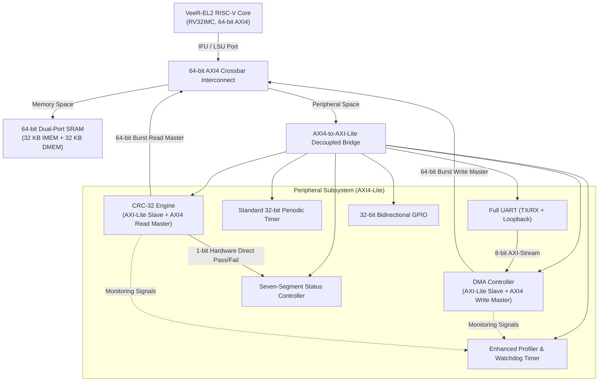

# WaveGuard SoC: RISC-V (VeeR-EL2) System-on-Chip

**Student ID**: `1602-23-735-045`  
**Core Architecture**: Western Digital / CHIPS Alliance **VeeR-EL2** (RV32IMC)  
**System Bus**: 64-bit AXI4 Multi-Master Interconnect + Decoupled AXI4-Lite Peripheral Bridge  
**Toolchain & Simulator**: Icarus Verilog (`iverilog 12.0`), VVP, Python 3, GTKWave (Windows / Linux Native)

---

## 1. System Overview

The **WaveGuard SoC** is an integrated System-on-Chip designed around the high-performance 32-bit RISC-V **VeeR-EL2** processor core. The platform integrates a partitioned 64-bit AXI4 memory subsystem (32 KB Instruction SRAM + 32 KB Data SRAM), an AXI4-to-AXI4-Lite bridge, three standard control peripherals (UART, 32-bit GPIO, Standard Timer), and four high-throughput hardware accelerators (DMA Controller, CRC-32 Engine, Enhanced Profiling Timer, and Seven-Segment Display Controller).



---

## 2. Complete SoC Memory Map

The system uses a 32-bit flat physical address space divided cleanly into memory and memory-mapped register regions:

| Address Range | Size | Target / Peripheral | Access Mode | Description |
|---|:---:|---|:---:|---|
| `0x0000_0000 - 0x0000_7FFF` | 32 KB | **Instruction SRAM (IMEM)** | Read / Execute | Reset vector (`0x0000_0000`), firmware image |
| `0x0000_8000 - 0x0000_FFFF` | 32 KB | **Data SRAM (DMEM)** | Read / Write | Stack, heap, DMA buffers, CPU mailboxes |
| `0x8000_0000 - 0x8000_0FFF` | 4 KB | **CRC-32 Engine** | Read / Write | 32-bit CRC calculation & polynomial verification |
| `0x8000_1000 - 0x8000_1FFF` | 4 KB | **DMA Controller** | Read / Write | 8-bit stream to 64-bit AXI4 memory write master |
| `0x8000_2000 - 0x8000_2FFF` | 4 KB | **Enhanced Timer** | Read / Write | Hardware profiler (DMA/CRC) & watchdog timers |
| `0x8000_3000 - 0x8000_3FFF` | 4 KB | **Seven-Segment Controller** | Read / Write | Hardware/software PASS, FAIL, IDLE display |
| `0x8000_4000 - 0x8000_4FFF` | 4 KB | **UART Controller** | Read / Write | TX/RX data, baud divisor, loopback test mode |
| `0x8000_5000 - 0x8000_5FFF` | 4 KB | **Standard Timer** | Read / Write | 32-bit periodic counter, prescaler, auto-reload |
| `0x8000_6000 - 0x8000_6FFF` | 4 KB | **32-bit GPIO Controller** | Read / Write | Direction, data output, data input, edge IRQ |

---

## 3. Peripheral IP Blocks

### Standard System IPs
1. **32-bit Bidirectional GPIO (`0x8000_6000`)**:
   - Software-configurable direction register (`DIR`), data output (`DATA_OUT`), and input pin sampling (`DATA_IN`).
   - Configurable rising/falling edge interrupt generation (`irq_gpio`).
2. **Standard 32-bit Periodic Timer (`0x8000_5000`)**:
   - 32-bit programmable prescaler, load value register, and auto-reload countdown.
   - Generates periodic system ticks (`irq_timer_std`).
3. **Full UART IP (`0x8000_4000`)**:
   - Independent TX FIFO, RX FIFO, programmable baud rate divisor, and internal loopback mode.
   - Converts incoming serial data into an 8-bit streaming interface directed to the DMA engine.

### Custom Accelerator IPs
4. **DMA UART-to-Memory Controller (`0x8000_1000`)**:
   - Autonomous 64-bit AXI4 Write Master.
   - Packs asynchronous 8-bit bytes into 64-bit quad-words and streams directly into SRAM without CPU intervention.
5. **CRC-32 Engine (`0x8000_0000`)**:
   - Autonomous 64-bit AXI4 Read Master implementing standard IEEE 802.3 Ethernet polynomial ($0xEDB88320$).
   - Features expected checksum register comparison and directly outputs hardware status flags.
6. **Seven-Segment Display Controller (`0x8000_3000`)**:
   - Decodes hardware PASS/FAIL lines directly from the CRC accelerator or via software CSR.
   - Drives physical 7-segment display patterns (`PASS`, `FAIL`, `IDLE`).
7. **Enhanced Profiling Timer (`0x8000_2000`)**:
   - Performance monitor tracking exact execution cycles of active DMA transfers and CRC-32 computations.
   - Dedicated hardware watchdog timers triggering interrupts on accelerator timeouts.

---

## 4. Software Application & Firmware

The SoC boots from `0x0000_0000` executing the mentor's required bare-metal C application:
```c
int add(int a, int b) {
    return a + b;
}

int main() {
    int x = 10;
    int y = 20;
    return add(x, y); // Returns 30
}
```

The startup code (`firmware/startup.s`) initializes the stack, invokes `main()`, and deposits the computed result (`30` / `0x0000001E`) into the Data Memory Mailbox at `0x0000_8100`.

- Memory image files: `firmware/program.hex` (`$readmemh` format) and `firmware/program.ihex` (Intel HEX).

---

## 5. Verification & VIP Suite

Verification includes both standalone unit-level tests and an end-to-end SoC testbench:

### Standalone Unit Tests (`tb/unit_tests/`)
Each IP has its own self-checking testbench:
- `tb_gpio_unit.sv`: Tests pin direction, data driving, input reading, edge IRQ.
- `tb_timer_std_unit.sv`: Tests periodic tick, prescaler, reload, IRQ clear.
- `tb_seven_segment_unit.sv`: Tests IDLE, software PASS, and hardware FAIL override.
- `tb_uart_unit.sv`: Tests baud generation, RX serial sampling, and CSR loopback.
- `tb_enhanced_timer_unit.sv`: Tests DMA/CRC cycle profiling and watchdog timeout.
- `tb_dma_unit.sv`: 58 tests for burst packing, alignment, backpressure, and bus faults.
- `tb_crc32_unit.sv`: 31 tests for standard IEEE 802.3 checksums, bursts, and masking.

### Verification IPs (VIPs)
1. **AXI4-Lite Master BFM**: Protocol-compliant 5-channel read/write driver.
2. **64-bit AXI4 Slave Memory VIP**: Multi-beat burst responder with latency and SLVERR error injection.
3. **UART Serial Protocol VIP**: Serial frame generator and transaction monitor.
4. **CRC-32 Golden Model**: Real-time algorithmic reference scoreboard.
5. **UVM 1.2 VIP Suite (`tb/vip/uvm/`)**: Complete class-based agents for commercial simulators (VCS/Verdi).

---

## 6. How to Run Simulation

### Prerequisites
- [Icarus Verilog](https://bleyer.org/icarus/) (version 12.0 or newer)
- Python 3.8+
- [GTKWave](http://gtkwave.sourceforge.net/) (optional, for viewing `.vcd` traces)

### Option A: Run Full SoC Simulation (End-to-End)
```cmd
.\scripts\run_sim.bat
```
Output:
```text
================================================================
   *** ALL SOC VERIFICATION TESTS PASSED (0 ERRORS) ***
   1. Instruction Memory & add(10,20) Execution : PASSED
   2. 32-bit GPIO Direction, I/O & Interrupts   : PASSED
   3. Standard Timer Periodic Interrupt         : PASSED
   4. Full UART TX/RX & Loopback CSR Mode       : PASSED
   5. DMA 64-bit Memory Streaming Ingestion     : PASSED
   6. CRC-32 IEEE 802.3 Memory Verification     : PASSED
   7. Seven-Segment PASS Hardware Display       : PASSED
   8. Enhanced Timer Profiling & Watchdog       : PASSED
================================================================
```

### Option B: Run Standalone IP Unit Tests
```cmd
.\scripts\run_unit_tests.bat
```
Executes all 7 IP unit testbenches in sequence with 0 errors.

### Option C: View Simulation Waveforms
```cmd
gtkwave waveguard_soc_tb.vcd
```
