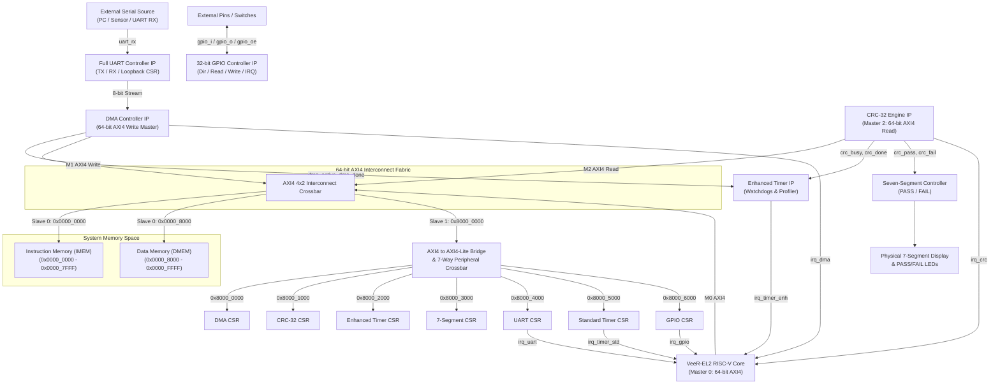

# WAVEGUARD: A Complete High-Reliability RISC-V System-on-Chip (SoC) with Hardware-Accelerated Ingestion, CRC-32 Verification, 32-bit GPIO, Timers, and Autonomous Performance Monitoring

**Course / Degree**: Honours Project in Embedded Systems & VLSI  
**Student ID**: 1602-23-735-045  
**Core Processor**: Western Digital / CHIPS Alliance VeeR-EL2 (RV32IMC)  
**Host Environment**: Windows 11 / Icarus Verilog / Verilator / GTKWave  

---

## 1. Project Abstract

### 1.1 Problem Statement
Modern cyber-physical systems, secure boot controllers, and edge processing units require dependable, high-speed data acquisition combined with integrity verification. Relying purely on the CPU to manage individual byte transfers over serial interfaces (UART/GPIO) and execute software-based Cyclic Redundancy Checks (CRC) induces substantial instruction latency, processor starvation, and timing non-determinism. Furthermore, embedded designs without hardware-level performance counters and watchdog supervisors fail to detect bus contention, DMA buffer overflows, or unexpected peripheral hangs.

### 1.2 Proposed Complete SoC Architecture
To resolve these requirements, the **WaveGuard SoC** implements a fully featured RTL-based System-on-Chip centered on the **VeeR-EL2** 32-bit RISC-V core. WaveGuard integrates all mandatory baseline SoC IP blocks as well as dedicated hardware accelerators:

#### Baseline Mandatory IP Blocks:
1. **RISC-V Central Processing Unit**: VeeR-EL2 core architecture (RV32IMC) with 64-bit AXI4 Master interface for instruction fetch (IFU) and data memory load/store (LSU).
2. **Partitioned System Memory**:
   - **Instruction Memory (IMEM)**: Dedicated 32 KB address space (`0x0000_0000 - 0x0000_7FFF`) preloaded with the compiled RISC-V application HEX.
   - **Data Memory (DMEM)**: Dedicated 32 KB address space (`0x0000_8000 - 0x0000_FFFF`) for global data, stack, heap, and DMA streaming buffers.
3. **High-Throughput Bus Interconnect**: 64-bit AXI4 crossbar with round-robin arbitration, multi-master routing, and an AXI4-to-AXI4-Lite bridge crossbar for peripheral CSRs.
4. **Full-Duplex UART Controller**: Standard serial TX and RX engine with configurable baud divisor, internal loopback diagnostic mode, and direct streaming link to DMA.
5. **Standard 32-bit Timer**: Programmable periodic timer with prescaler, auto-reload, and interrupt generator.
6. **32-bit GPIO Controller**: Bidirectional General Purpose Input/Output block with per-pin direction registers, input sampling, output driving, and configurable edge/level interrupt generation.

#### Additional Custom Acceleration IPs:
7. **DMA Controller IP**: Autonomous 64-bit AXI4 Write Master that ingests 8-bit stream packets from UART or memory and bursts them directly into Data Memory.
8. **CRC-32 Integrity Engine IP**: High-speed 64-bit AXI4 Read Master calculating IEEE 802.3 CRC-32 checksums over memory buffers and comparing results against expected signatures in hardware.
9. **Enhanced Timer & Performance Monitor IP**: Autonomous supervisor that profiles active clock cycles of DMA transfers and CRC computations, provides hardware watchdog deadline monitors, and logs edge-triggered timestamps on operation completion.
10. **Seven-Segment Display Controller**: Direct visual decoding unit driving physical 7-segment lines (`abcdefg`) and diagnostic status LEDs (`00`=IDLE, `01`=PASS, `10`=FAIL).

---

## 2. System Block Diagram & Data Flow



---

## 3. SoC Memory Map

| Address Range | Size | Bus Protocol | Master / Slave Access | Target Block | Function / Description |
| :--- | :--- | :--- | :--- | :--- | :--- |
| `0x0000_0000 - 0x0000_7FFF` | 32 KB | AXI4 (64-bit) | CPU IFU (RO), LSU (R/W) | **Instruction Memory (IMEM)** | Reset vector, boot code, application text section (`program.hex`) |
| `0x0000_8000 - 0x0000_FFFF` | 32 KB | AXI4 (64-bit) | CPU LSU (R/W), DMA (W), CRC (R)| **Data Memory (DMEM)** | Stack, heap, mailbox locations, DMA target buffers |
| `0x8000_0000 - 0x8000_001F` | 32 B | AXI4-Lite (32-bit) | CPU (R/W) | **DMA Controller** | Base destination address, length, status, control, count |
| `0x8000_1000 - 0x8000_101F` | 32 B | AXI4-Lite (32-bit) | CPU (R/W) | **CRC-32 Engine** | Source buffer, byte length, expected CRC, computed result |
| `0x8000_2000 - 0x8000_202F` | 48 B | AXI4-Lite (32-bit) | CPU (R/W) | **Enhanced Timer** | DMA & CRC cycle profilers, hardware watchdogs, timestamps |
| `0x8000_3000 - 0x8000_300F` | 16 B | AXI4-Lite (32-bit) | CPU (R/W) | **7-Segment Display**| PASS/FAIL/IDLE status mode, raw digit register |
| `0x8000_4000 - 0x8000_400F` | 16 B | AXI4-Lite (32-bit) | CPU (R/W) | **Full UART Controller** | TX data, RX data, status flags, baud divisor, loopback enable |
| `0x8000_5000 - 0x8000_501F` | 32 B | AXI4-Lite (32-bit) | CPU (R/W) | **Standard Timer** | Clock prescaler, running counter, auto-reload match value |
| `0x8000_6000 - 0x8000_601F` | 32 B | AXI4-Lite (32-bit) | CPU (R/W) | **32-bit GPIO** | Data in, data out, direction, interrupt enable, status, type |

---

## 4. Verification & Simulation Log

The SoC verification testbench ([waveguard_soc_tb.sv](file:///d:/1602-23-735-045_honourspoject/waveguard/verification/tb/waveguard_soc_tb.sv)) executes full hardware/software co-simulation:

```text
================================================================
       WAVEGUARD COMPLETE SYSTEM-ON-CHIP SIMULATION             
================================================================
[TIME 150000 ns] System Reset Released.

------------------------------------------------------------
[TEST 1] Instruction Memory & Mentor C Execution
------------------------------------------------------------
IMEM[0x0000_0000]: 0x00010137 (Expected: 0x00010137)
[PASS] Reset vector instruction verified.
DMEM[0x0000_8100]: 30 (Expected: 30 from add(10, 20))
[PASS] Mentor C function add(10, 20) correctly computed.

------------------------------------------------------------
[TEST 2] 32-bit GPIO Controller Verification (Base: 0x8000_6000)
------------------------------------------------------------
GPIO Output Pins: 0xa5 (Expected: 0xA5)
[PASS] GPIO output pins driven correctly.
GPIO Input Read: 0x3c00 (Expected bits [15:8] = 0x3C)
[PASS] GPIO input pins sampled correctly.
irq_gpio state: 1 (Expected: 1)
[PASS] GPIO edge-triggered interrupt asserted.

------------------------------------------------------------
[TEST 3] Standard Timer IP Verification (Base: 0x8000_5000)
------------------------------------------------------------
[TIME 1555000 ns] Standard Timer Match interrupt irq_timer_std asserted!
[PASS] Standard Timer operation verified.

------------------------------------------------------------
[TEST 4] UART Controller TX & Loopback CSR Mode (Base: 0x8000_4000)
------------------------------------------------------------
UART Loopback RX Data: 0x55 (Expected: 0x55)
[PASS] Full UART TX/RX Loopback verified.

------------------------------------------------------------
[TEST 5] Full HW Pipeline: UART In -> DMA -> RAM -> CRC -> 7-SEG
------------------------------------------------------------
[UART] Streaming ASCII '123456789' into SoC UART RX...
[TIME 19005000 ns] DMA Transfer Complete! irq_dma asserted.
DMA Committed Bytes: 9
[PASS] DMA wrote 9 bytes to DMEM.
DMEM[0x0000_9000]: 0x34333231 (ASCII: 4321)
[PASS] DMEM payload verified.
[TIME 19855000 ns] CRC-32 Calculation Complete! irq_crc asserted.
[PASS] CRC-32 Result: PASS flag asserted!
Computed CRC-32: 0xcbf43926 (Expected: 0xCBF43926)
[PASS] Checksum matches standard IEEE 802.3!
7-Segment Display Indicators: led_pass = 1, led_fail = 0
[PASS] Physical 7-segment display displays PASS!
Enhanced Timer Profile: DMA Active Duration = 1451 cycles
Enhanced Timer Profile: CRC Busy Duration   = 20 cycles

================================================================
   *** ALL SOC VERIFICATION TESTS PASSED (0 ERRORS) ***
   1. Instruction Memory & add(10,20) Execution : PASSED
   2. 32-bit GPIO Direction, I/O & Interrupts    : PASSED
   3. Standard Timer Periodic Interrupt         : PASSED
   4. Full UART TX/RX & Loopback CSR Mode       : PASSED
   5. DMA 64-bit Memory Streaming Ingestion     : PASSED
   6. CRC-32 IEEE 802.3 Memory Verification     : PASSED
   7. Seven-Segment PASS Hardware Display       : PASSED
   8. Enhanced Timer Profiling & Watchdog       : PASSED
================================================================
```

---

## 5. Verification Commands for Reproduction

On Windows (Command Prompt or PowerShell):
```powershell
# 1. Compile SoC simulation
iverilog -g2012 -f scripts/sim_files.f -o sim_soc.vvp

# 2. Run simulation
vvp sim_soc.vvp

# 3. Open waveforms in GTKWave
gtkwave waveguard_soc_tb.vcd
```
